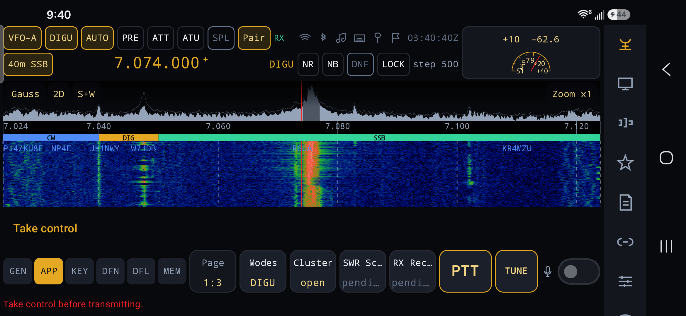
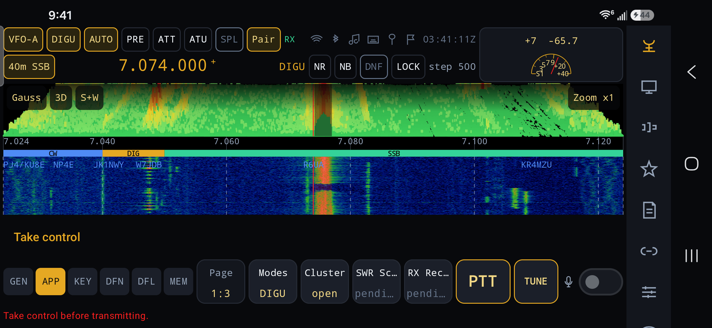
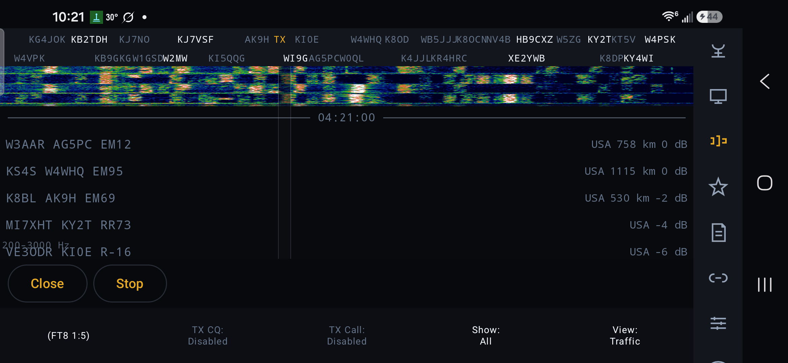
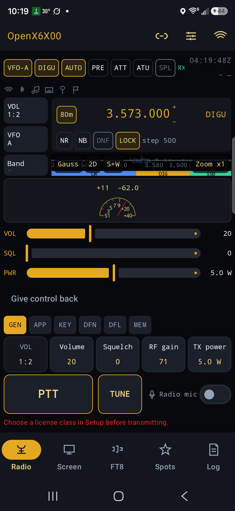
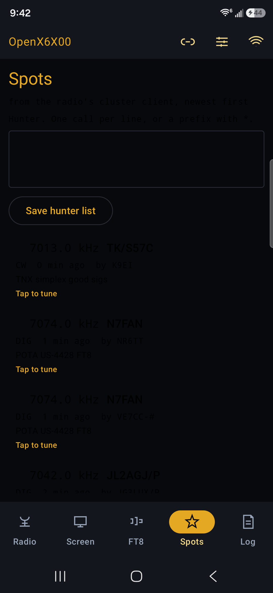

# OpenX6X00-Android

An open, community companion app for the Xiegu X6100 running the
[OpenX6X00](https://github.com/Guru-RF/OpenX6X00) firmware. **Android only** for now.

By KD0CQ ([theMadCatter](https://github.com/theMadCatter)).

> **Alpha release.** This is an early public build. It is probably buggy in
> places. Use it at your own risk.
>
> Before any on-air transmission, test into a dummy load first. Confirm the
> power, band and mode. Choose your license class in Setup, and stay in
> control of the radio. You are responsible for your transmissions under
> your license. The on-air checklist is [docs/tx-checklist.md](docs/tx-checklist.md).



*The radio face in landscape, following the radio's RF.Guru layout. 40 m at 7.074 MHz, live spectrum and waterfall.*

## Download

A signed APK for this alpha is in
[GitHub Releases](https://github.com/theMadCatter/OpenX6X00-Android/releases/latest).
Sideload it on your phone, and allow installation from unknown sources if
Android asks.

## What it does

- **Radio face.** One screen laid out like the radio's RF.Guru UI: VFO A/B, mode, AGC,
  PRE, ATT, ATU, a needle S-meter (TX watts, SWR and ALC while transmitting), the
  frequency strip, and a live spectrum and waterfall. Landscape follows the radio's
  800×480 main screen, and portrait follows the walkie layout. There is an optional 3D
  spectrum view and a high-contrast sunlight theme.
- **Screen.** A mirror of the radio's own display.
- **Digital modes.** Each one is drawn like that mode's own window on the radio.
  - **FT8 / FT4 / FT2:** call lane, waterfall, a see-through decode list or 3×3 tiles,
    and the radio's button pages.
  - **JS8 (needs firmware v0.3.13 or later):** drives the radio's built-in JS8 engine,
    with a waterfall, band activity and directed messages, and a **GhostNet** filter
    for @GHOSTNET, @GSTFLASH and your regional group.
  - **WeFax:** the chart, station and frequency, and the RX Auto/Cont status.
  - **CW:** decoded text with the radio's word colours.
  - PSK, RTTY, Olivia, SSTV, WSPR and Navtex aren't streamed by the firmware yet, so
    they show as pending.
- **Spots and Log.** Live spots on the spectrum, and a logbook with backup and export.
  Backups never include the pairing token, the QRZ password or the log itself.
- **Audio and PTT.** RX/TX audio over TCI, and hold-to-talk with a lease that always
  unkeys on release.
- **Background running.** A foreground service keeps the link up when the screen is off.

## Screenshots

| 3D spectrum | FT8 |
| --- | --- |
|  |  |
| *Optional 3D spectrum view, same 40 m session.* | *FT8 in landscape: two-row call lane, waterfall and live decodes.* |

| Portrait | Spots |
| --- | --- |
|  |  |
| *Portrait, following the radio's walkie layout.* | *Spots from the radio's DX cluster client.* |

## Getting started

1. **Firmware.** Flash the X6100 with [OpenX6X00](https://github.com/Guru-RF/OpenX6X00).
   JS8 in this app needs firmware **v0.3.13 or later**.
2. **Browser remote.** On the radio, open **Settings > General > BROWSER REMOTE**
   and turn it on (it is on by default). That starts the panel server this app
   uses, on port **50002**. TCI audio, on port **50001**, is also on by default;
   **Settings > General > TCI SERVER** can turn it off or change the port.
3. **Same network.** Put the phone and the radio on the same Wi-Fi or LAN.
   The radio advertises itself as `x6100.local`. Its IP address is shown in
   **Settings > Wireless** (the WIFI card lists power, status, IP and networks).
   If `.local` does not resolve on the phone, type that IP instead.
4. **Install the app.** Download the
   [latest release APK](https://github.com/theMadCatter/OpenX6X00-Android/releases/latest)
   and sideload it (allow installation from unknown sources if Android asks).
   You can also [build from source](#building).
5. **Connect.** Open the app, Search or enter the host, then **Connect to**
   that address. When the link is up, press **Open the radio**.
6. **Pair.** A new session is view only until it is paired. Open **Pair**
   (from the Connect screen or the Pair control on the radio face) and press
   **Show a code on the radio**. The radio puts a **six-digit** code on its
   screen for **two minutes**. **Settings > General > BROWSER REMOTE > Pair
   code** shows the same code again if you need it. Type the digits and a
   name for this phone (**This app is**), then **Pair**. Later connections
   reuse the stored token and do not need a new code.
7. **Take control.** Pairing is not the same as holding the controls. Press
   **Take control** to operate the radio. **Give control back** releases it.
   The radio's own keys and knobs take control back for the operator at the
   radio.
8. **Before any transmit.** Choose your license class in **Setup**. Then test
   into a dummy load first, and work through
   [docs/tx-checklist.md](docs/tx-checklist.md). You are responsible for your
   transmissions under your license.

### Troubleshooting

- **Take control does nothing**, or the face says **Pair this phone to take
  control.** The session is not paired, so it is view only. Pair the phone
  first, then take control.
- **`err view only: pair this browser to operate`**, or **Connected, view
  only: pair to operate.** Same cause: the link is up, but this session has
  not been paired.
- **The app cannot connect.** Confirm the phone and radio are on the same
  network, the host is `x6100.local` or the IP from **Settings > Wireless**,
  and **BROWSER REMOTE** is on. The panel WebSocket is port **50002**; TCI
  audio is port **50001**. If the server is off, the radio says **BROWSER
  REMOTE is off (General): turn it on**.

## Safety

Every transmit action requires **Take control**, the operate role, and the session's
transmit flag, and it asks before it keys. The band check is under Transmitting.
The app never stores QRZ credentials in backups.

## Transmitting

Pair the phone with the radio, then press **Take control**. The session needs the
operate role and its transmit flag. Until both are true, PTT, Tune, power, and
every digital transmit word stay off the air.

**PTT** is hold-to-talk. The hold is the question. The radio's own microphone is
`key PTT 1 HOLD`, renewed every second, and `key PTT 0` when the finger comes up.
The phone's microphone is `trx:0,true,tci;` with TX audio, and `trx:0,false;` to
unkey. Letting go, losing the link, losing control, losing the transmit flag, a
refused write, leaving the screen, or the service stopping all unkey. The radio
also drops a lease that is not renewed.

**FT8, FT4 and FT2** are the radio's FT8 engine. CQ, TX Call, a reply and Auto
send `ft8 cq`, `ft8 txcall`, `ft8 reply` and `ft8 auto`. Each asks first. Turning
one off sends the same word and does not need the frequency to be legal, so a
bad offset cannot leave the transmitter on. `ft8 stop` is sent when the screen
goes away, the service stops, control is given back, or the session may no
longer transmit.

**JS8** sends `js8 send`, `js8 cq`, `js8 autocq`, `js8 hb`, `js8 hbnow` and
`js8 auto`. Send, CQ, Auto CQ, Heartbeat, HB now and Auto ask before they start.
Turning Heartbeat or Auto off does not. The TX offset is `js8 txfreq`. Moving it
does not key, and the offset being asked for is what the band check sees.
`js8 stop` goes out with `ft8 stop`. There is no `js8 tx`.

**Tune** is `tune 1 HOLD` for an external tuner, renewed every second, and
`tune 0` when the finger comes up or any of the unkey cases above. It is not
the ATU switch. `set atu` only enables the tuner.

**WeFax** has no transmit word on the panel. The radio can transmit a fax from
its own screen. This app cannot start one.

**Power** is `set pwr`, in tenths of a watt. It needs Take control and the
transmit flag. It does not key. FT8 and JS8 transmissions are limited to **7 W**
by the radio (`TX_PLAYER_MAX_PWR_W`). The radio applies that cap while those
modes transmit and then restores the power. Voice and Tune use the power you
set, up to the radio's own maximum. 30 m is 200 W PEP and 60 m is 100 W ERP.
This radio is below the PEP figure, and ERP depends on the antenna, so the app
does not turn either into a power command.

**Band and license.** Setup starts with no license class and the US check on,
so transmitting is blocked until a class is chosen: Technician, General,
Advanced or Extra. The tables are 47 CFR 97.301 and 97.305, ITU Region 2.
The whole signal has to sit inside one segment for that class and that
emission. Voice uses the mode (phone, CW, or data). FT8, FT4, FT2 and JS8 are
data. Tune is a carrier at the dial in the current mode. 60 m is the five
2.8 kHz channels, not one continuous span. Operators outside the United States
can turn the check off. The warning on that switch is the point: the app will
not keep the transmission inside a US band, and the operator is responsible
for the rules where they are. Take control, the transmit flag, the question
before keying, and the unkey all stay.

You are the control operator. A license, a legal frequency, and a legal power
are yours to get right. The check is a backstop, not a license, and it does
not know local restrictions or antenna gain. Use a dummy load or low power
until you have confirmed a path. The on-air checklist is [docs/tx-checklist.md](docs/tx-checklist.md).

## How it talks to the radio

- mDNS discovery (`x6100.local`) or a manual host. The last host is remembered.
- The Remote/Panel WebSocket on port 50002 handles pairing, control, the PTT lease,
  state, spectrum, FT8, JS8, CW, WeFax, spots and logging.
- TCI on port 50001 handles RX/TX audio and PTT.

The protocol shapes come from the firmware sources in the
[firmware repo](https://github.com/Guru-RF/OpenX6X00). Nothing on the wire is
invented. If something isn't on the socket (country flags, CW speed, the RTTY scope),
the app doesn't fake it.

## Requirements

- Android 8.0 (API 26) or newer.
- A Xiegu X6100 on OpenX6X00 firmware. JS8 needs v0.3.13 or later.

## Building

    ./gradlew testDebugUnitTest assembleDebug

Kotlin and Jetpack Compose. Testing without a radio: build OpenX6X00's PC version with
the stub radio (`host/build.sh` in the firmware repo) and point the app at that PC.

## Project layout

```
app/src/main/kotlin/radio/kd0cq/x6100/
  net/        panel (50002) and TCI (50001) clients and their pure codecs
  audio/      RX/TX audio over TCI
  ptt/        PTT lease control with a fail-safe unkey
  discovery/  NSD browse, manual host+port fallback
  service/    the foreground service that owns the connection
  ui/         Connect, Pairing, Radio, Screen, FT8, JS8, WeFax, CW, Spots, Log, Settings
app/src/test/ codec unit tests built from the firmware's real lines and frames
```

## Status

Alpha. Tested receive-only against a real X6100. The panel state line sends
battery (`bat`). A reading of 0..100 is shown, and -1 (no pack reading) is
hidden. The state line does not send a clock, so the header clock is the
phone's UTC. Transmit is implemented; on-air confirmation is still the
operator's, into a dummy load first. See [docs/tx-checklist.md](docs/tx-checklist.md).

## Spirit and license

The ham community is about sharing information with the community, not profiting off
the backs of others' work. This app is built in that non-commercial, give-it-back spirit.

Licensed under the **GNU General Public License v3.0 or later** (see `LICENSE`).
Anyone who distributes this app or anything built from it must publish their source
under the same terms, so it can never be closed up.

73 de KD0CQ
